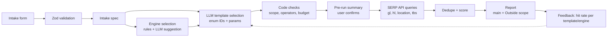

# Architecture

## Stack

| Layer      | Tool                                                                        | Why                                                                         |
| ---------- | --------------------------------------------------------------------------- | --------------------------------------------------------------------------- |
| Language   | TypeScript                                                                  | Type safety end to end                                                      |
| Validation | Zod                                                                         | One schema for form, backend and LLM output ([D-005](./Decisions.md#d-005)) |
| Search     | SERP API (Serper / SerpAPI / Brave / Bing — TBD)                            | [D-001](./Decisions.md#d-001)                                               |
| Repo       | pnpm workspaces + Turborepo                                                 | Shared schema across packages ([D-014](./Decisions.md#d-014))               |
| Frontend   | React + Vite, Tailwind, shadcn/ui, React Hook Form, Zustand, TanStack Query | Tool behind login, no SEO                                                   |
| Backend    | Node 24 + Hono                                                              | TS-first, light                                                             |
| DB         | PostgreSQL + Orchid ORM                                                     | Preferred ORM requires Postgres                                             |
| Auth       | Better Auth                                                                 | Audit log for authorized security runs                                      |
| Env        | t3-env (`@dextra/env`)                                                      | Fails at startup on missing/invalid keys, never prints values               |
| Tooling    | Biome, Vitest, Lefthook, GitHub Actions                                     | Lint/format, tests, pre-commit, CI                                          |

## Packages

| Package             | Status            | Contents                                                                                                                                                                                                                                                                                                                                                                                                                                                                                 |
| ------------------- | ----------------- | ---------------------------------------------------------------------------------------------------------------------------------------------------------------------------------------------------------------------------------------------------------------------------------------------------------------------------------------------------------------------------------------------------------------------------------------------------------------------------------------- |
| `packages/core`     | Schema to report  | `IntakeSpecSchema` (all form fields, cross-field rules), enums, domain/URL validators, ISO lists, `isSecurityRun`, `needsKeywordFollowUp`                                                  ; `TEMPLATES`, `TemplateIdSchema`, `getTemplate`, `templatesForGoal`, `paramValuesFor` ; `buildPlan`, `SelectionSchema`, `checkQuery`, `checkResult` ; `SELECTOR_SYSTEM_PROMPT`, `ruleBasedSelections`, `routeEngines`, `applyExclusions` ; `runPlan`, `scoreResults`, `toCsv`, `groupByGoal` |
| `packages/env`      | Done              | `createServerEnv()` — typed server env, requires ≥1 SERP key                                                                                                                                                                                                                                                                                                                                                                                                                             |
| `packages/serp`     | Adapters done     | `SerpProvider` interface; Serper (Google web/news/scholar), SerpAPI (Google + Bing web), Brave (web/news); `createProviders`, `resolveProvider`; spike script `scripts/operator-matrix.ts`                                                                                                                                                                                                                                                                                               |
| `packages/selector` | Done (mocked)     | `selectTemplates(spec)` — Claude Opus 5.5 structured output, retry, rule-based fallback                                                                                                                                                                                                                                                                                                                                                                                                  |
| `packages/db`       | Code done (T-014) | Orchid ORM tables `run`, `result`, `authorization`, `template`, `template_stat`, `serp_location`; `createDb`, `seedTemplates`; hand-written migrations                                                                                                                                                                                                                                                                                                                                   |
| `apps/api`          | Code done (T-014) | Hono + Better Auth; `/api/spec/validate`, `/api/plans`, `/api/runs`, `/api/runs/:id/confirm` (starts the run), `/api/runs/:id/results`, `/api/runs/:id/export`, `/api/locations`                                                                                                                                                                                                                                                                                                         |
| `apps/web`          | Not started       | See [Implementation Plan](./Implementation-Plan.md)                                                                                                                                                                                                                                                                                                                                                                                                                                      |

## Pipeline



## Components

- **Intake form** — basic and advanced modes; dropdowns store canonical codes. See [Intake Form Spec](./Intake-Form-Spec.md).
- **Template library** — records with `id`, `goal`, `query`, `params` (enums), `engines`, `signal`, `priority`.
- **Template selector** — LLM via tool calling; template IDs are an enum. Output validated by Zod.
- **Engine router** — rules first, LLM may add one engine with a reason, user override in advanced mode ([D-004](./Decisions.md#d-004)).
- **Guardrails** — scope check on every `site:`, per-engine operator check, query budget cap, authorization gate for security goals.
- **Runner** — sends queries to the SERP API with location, language and time parameters; runs Soft-fallback batches.
- **Scorer** — dedupes URLs, scores by how many queries surfaced them, splits main vs Outside scope.

## Template record

```yaml
# full field list and all templates: Template-Library.md
id: doc_by_type
goal: documents
query: "filetype:{ext}" # signal only; compiler adds site: from scope_mode
params: { ext: [pdf, docx, xlsx, pptx] }
max_pick: 4
combine: or
scope_mode: optional
engines: [google, bing, brave]
signal: "URL ends in the requested extension"
priority: 1
sensitivity: normal
status: approved
```
